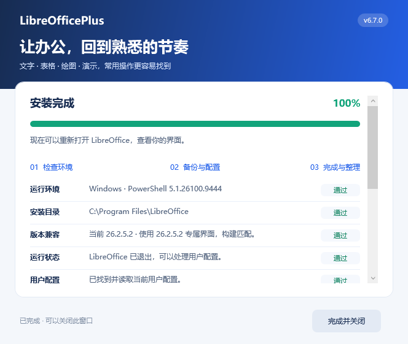
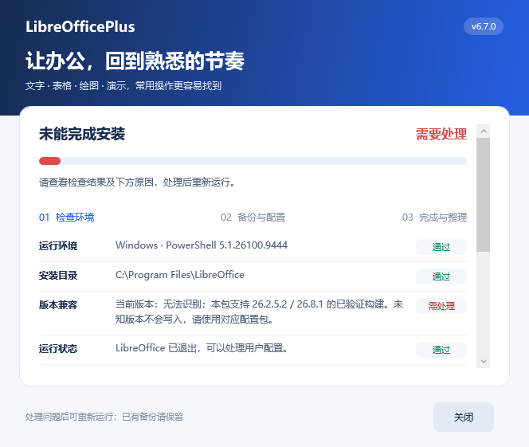
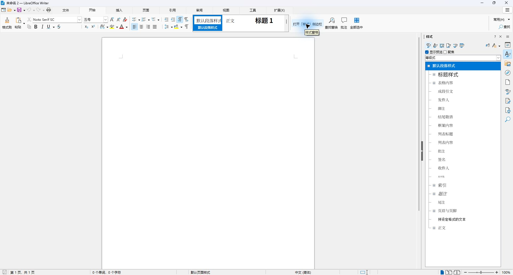
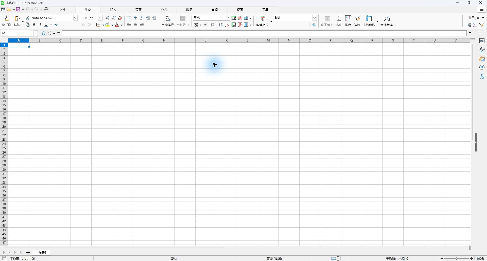
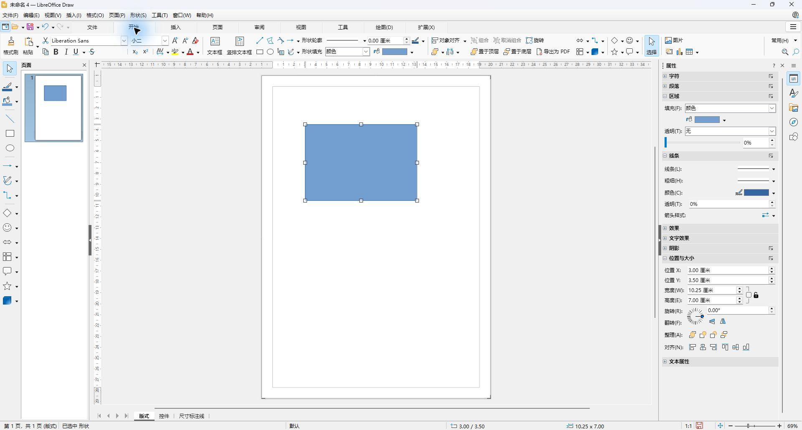

# LibreOfficePlus

为习惯 WPS 的用户提供 **LibreOffice Writer（文字）、Calc（表格）、Draw（绘图）、Impress（演示）**的中文功能区、常用操作和可恢复的一键配置包。

当前版本 **v6.7.0，兼容升级与官方提醒管理**。适配 **26.2.5.2、26.2.6.1** 与 **26.8.1（完整版本 26.8.1.1）**，按构建选用对应原生界面文件。参考常见办公操作习惯，调整按钮顺序、分组、常用菜单和键位；四模块使用 LibreOffice 原生命令、Colibre 图标与文档引擎。支持版本核实日期：2026-10-13，[官方下载页](https://www.libreoffice.org/download/)。

本版安装后关闭 LibreOffice 自动升级提醒、自动下载及增量自动更新，新增 **`兼容升级.vbs`**：只缓存已适配版本的官方安装包，验证校验值和数字签名，升级后重新配置原有模块。详见[兼容升级](docs/兼容升级.md)。已有[界面间距说明](docs/界面间距说明.md)继续保留，**本版没有改变顶部选项卡宽度**。后续更新仅在本仓库维护和发布，不向 LibreOffice 官方提报；需要本体代码修改的项目列为当前限制。[本体补丁参考](upstream/notebookbar-spacing/README.md)仅供开发研究，不会由安装程序应用。

2026-10-12 安装入口更新：修复 `'d'`、`'rshell.exe' 命令截断，并新增图形进度窗口。请重新下载并解压完整配置包，双击新的 `安装.vbs`；原来的首次备份会继续保留。

## 下载与安装

**[下载正式发布的配置包](https://github.com/cootom-png/libreofficeplus/releases/latest)**，选择 `LibreOfficePlus.zip`。同页提供 `SHA256SUMS.txt` 和 `release.json`，可核对文件校验值与完整提交。也可[下载 main 已合入版本](https://github.com/cootom-png/libreofficeplus/raw/refs/heads/main/dist/LibreOfficePlus-WPS%E7%95%8C%E9%9D%A2%E9%85%8D%E7%BD%AE%E5%8C%85.zip)。仓库旧 ZIP 文件名为保持下载兼容继续保留；正式发布使用 ASCII 文件名，避免平台自动改名造成清单不一致。

1. 使用 Windows x86-64 版 **LibreOffice 26.2.5.2、26.2.6.1 或 26.8.1.1**，已验证构建见下表；初次使用仍须已安装本体；兼容升级入口只提供已适配版本之间的升级。
2. 首次使用时，先启动并关闭一次 LibreOffice，让软件生成用户配置。
3. 保存文档，完全退出 LibreOffice。后台仍有进程时安装程序会拒绝修改，不会强制关闭文档。
4. 解压整个 ZIP，进入 `LibreOfficePlus` 文件夹，双击 **`安装.vbs`**。选择模块、查看字体提示及安装路径，点击“开始配置”，再查看逐项环境检查和进度。
5. 重新打开所需组件，建议最大化窗口查看“开始”页。

窗口预选四个模块，可按需取消；至少选择一个模块才能开始。写入当前用户配置，通常不需要管理员权限。模板为可选的新文档起点，完成后可点击“查看新文档模板”，不会自动成为默认模板。请保留解压目录和首次备份。安装会关闭当前用户的官方升级提醒、自动下载与自动更新；部分恢复保持关闭，全部模块恢复后还原原值。企业部署、手动安装及外部软件管理器不受此用户设置控制。

图形安装和恢复使用蓝白窗口，显示实际操作阶段、进度和完成结果；出现问题时在窗口中说明原因。操作期间请等待完成后再关闭窗口或打开 LibreOffice。`安装.vbs`、`恢复原界面.vbs` 使用 Windows Script Host 启动，不弹出黑色控制台；`.cmd` 保留为命令行入口。若电脑禁用了 Windows Script Host，可继续使用 `.cmd`，无需修改安全策略。

安装过程中逐项显示运行环境、安装目录、版本兼容、软件运行状态、用户配置、目录写入、配置包文件与首次备份，结果保留到关闭窗口。兼容检查展示实际版本和选用的专属界面，同时核对程序版本及构建；未知版本、文件缺失或新旧模块混用会停止并提示原因。失败项标红，未执行项明确显示“未检查”。恢复不要求版本匹配；目录写入检查不代表已诊断所有安全软件策略。






图形入口也可指定模块或安装路径：

```powershell
powershell.exe -NoProfile -STA -ExecutionPolicy Bypass -WindowStyle Hidden -File .\installer-ui.ps1 -Modules Writer,Calc -LibreOfficePath "D:\Apps\LibreOffice"
```

可在解压目录的 PowerShell 中选择模块，重复安装或追加模块会保留首次备份：

```powershell
.\安装.cmd -Modules Draw
.\安装.cmd -Modules Writer,Calc
```

默认程序路径是 `C:\Program Files\LibreOffice`。自定义安装路径示例：

```powershell
powershell.exe -NoProfile -ExecutionPolicy Bypass -File .\configure.ps1 -Modules Writer,Calc,Draw,Impress -LibreOfficePath "D:\Apps\LibreOffice"
```

## 版本兼容

| LibreOffice 完整版本 | 已验证构建 | 专属界面 |
| --- | --- | --- |
| 26.2.5.2 | `cd7284b4cbbfeb507e630c1aac019f4157393acb` | `ui/`、`profile/` |
| 26.2.6.1 | `d1ee4fa77ef37aa4cfa80ea6fd156dcae5d60263` | 原生文件一致，共用 `ui/`、`profile/` |
| 26.8.1.1（官方显示 26.8.1） | `bf6ef2662401c7d6dce671ab4deb26ee0af3a7c1` | `variants/26.8.1/` |

建议使用 **`兼容升级.vbs`**：保存文件并退出后，按本包兼容清单升级，自动重新配置原有全部模块。当前允许 26.2.5.2 或 26.2.6.1 → 26.8.1.1，已是最高兼容版本时不重复安装；未适配版本不放行。升级失败或要求重启时保留缓存和备份，再次运行入口继续；本助手不自动回滚本体。手动升级或降级后，首次打开文档前仍须运行安装入口，**同时勾选以前配置过的所有模块**。首次备份继续保留；只想恢复原界面时使用本版恢复入口，无需匹配软件版本。

新版开始页保留新的原生网格、字体字号、段落、数字和样式控件；沿用项目的选项卡习惯、格式刷入口及常用菜单。新版额外主题页和扩展页继续保留，布局不承诺与旧版或 WPS 完全相同。每版分别构建并检查四模块 UI 与 24 类右键菜单；快捷键和可选模板共享。

详见 [版本兼容与验证边界](docs/版本兼容.md)。新版未完成真实窗口逐项点击、全屏放映与所有缩放排版检查；复杂文档应先用副本核对。

## v6.5 演示模块

Impress 加入同一套安装、首次备份、追加安装和按模块恢复流程。**尚无用户提供的 WPS PPT 截图，本版依据官方公开操作说明和通用演示习惯独立组织，不承诺逐像素一致。**

- 选项卡：文件 → 开始 → 插入 → 设计 → 切换 → 动画 → 放映 → 审阅 → 视图 → 工具；表格、图片、媒体、绘图和母版上下文页继续保留。
- 开始：格式刷、剪贴板、新建/版式/复制/删除幻灯片、字体、段落、形状、排列与放映入口。普通视图打开左侧缩略图，右侧保留原生属性窗格。
- 设计：大小/背景打开原生幻灯片设置，母版设计与母版编辑分开；切换、动画打开各自原生侧栏。动画细节和计时在原生侧栏设置。
- 右键：新增 8 类演示菜单，集中幻灯片管理、字体段落、对象排列和动画入口；保留原生命令、可用条件与动态菜单。
- 快捷键：Ctrl+M 新建幻灯片，Ctrl+G / Ctrl+Shift+G 组合/取消组合，Shift+F9 网格，F12 另存为，Ctrl+Alt+V 选择性粘贴；保留 F5 从头、Shift+F5 从当前页放映。未全局改写 Ctrl+D，避免把复制对象错误变成复制幻灯片。
- 可选 `WPS习惯演示.otp`：独立制作的 16:9 空白模板（28 × 15.75 cm），默认文字宋体 24 磅。模板不会改写现有 PPT 或默认模板。

只安装演示：`安装.cmd -Modules Impress`；图形窗口可只勾选“Impress 演示”。旧用户可追加安装并保留首次备份。

[演示适配与验收](docs/演示适配.md)记录原生检查、快捷键、PPTX/ODP 往返与限制。**可见 Impress 测试实例未能连接，尚未完成按钮逐项点击、真实全屏放映、隐藏幻灯片选区、动画预览与不同缩放下的排版验收。** 复杂 PPTX 动画、字体、母版兼容性仍需用副本检查。

## v6.4 常用操作与安装体验

| 区域 | 改进 |
| --- | --- |
| Writer | “格式设置”加入样式检查；字体外观与段落设置区分；样式预览说明可能改变缩进和行距 |
| Calc | “粘贴选项”集中粘贴值、格式、公式与完整设置；值包含文本及公式计算结果，保留目标格式 |
| 入口名称 | OLE 对象使用“嵌入对象”；导入工作表使用“从文件导入工作表” |
| 布局 | 常用操作两行增加间距；收起已清空的按钮容器，保留其他原生控制器 |
| Draw | 默认收起传统菜单栏，右上角菜单仍可访问和重新显示菜单栏；安装与恢复记录此设置 |
| 安装与发布 | 开始前选择模块和安装路径，提示宋体可用性；固定版本包附完整提交与校验值 |

本轮交付配置层改进。编辑状态相关快捷键、原生弹窗内部布局和多文档标签切换仍在后续计划，详见[适配计划](docs/适配计划.md)。

## v6.3 布局排查与入口纠正

纠正“目录级别”“文字方向”“繁转简”三类入口名称，使其准确说明原生动作。新增 50 项布局检查与 16 个窄文字框风险观察；已安装配置包与未安装的原生实例分别对照，结果见 [布局排查](docs/布局排查.md)。

**旧文档中的窄文字框若被固定行高遮住，应用标题/正文样式、改变行距或对整段清除格式，可能撑开段落并改变分页。此风险仍存在，v6.3 没有修改文档引擎或自动删除文字框。** 出现异常先撤销，在副本中检查框的宽度、锚定和行距；只想改变标题外观时可先调整字体、字号与对齐，并检查分页。

## v6.2 快捷键适配

配置 22 个键位，并验证 25 个保留的原生键位。Writer 增加字数统计、上下标、单倍/双倍行距和修订；Calc 增加向右填充、名称框定位、插入单元格、自动求和和图表向导；Draw 使用 Ctrl+G 组合、Ctrl+Shift+G 取消组合。三个模块统一 F12 另存为、Ctrl+Alt+V 选择性粘贴。

新增键位也使用 LibreOffice 能读取的 Key 集合格式，支持旧备份升级、重复安装和按模块恢复。包内附“快捷键对照表.csv”，具体替换的动作与边界见 [操作习惯](docs/操作习惯.md)。**Calc 的 Alt+Enter 换行、Ctrl+Enter 批量输入，Writer 的 Ctrl+Shift+C/V 格式复制，以及 WPS 多文档标签切换尚未完整对齐。** Calc 的 F4 保留公式引用切换，图表与定位继续使用原生向导和名称框。

## v6 弹出菜单与弹窗入口

- 重排 Writer、Calc、Draw 的 16 类常用右键菜单，按剪贴板、格式、对象操作、批注等分组；保留全部原生命令和动态子菜单。
- Writer 字体、段落直接出现在文字/表格右键中；开始页增加“格式设置”。Calc 集中单元格格式、行高列宽与清除内容。Draw 增加“形状设置”，集中填充、轮廓及大小位置。
- 常用下拉增加分隔线；菜单显示图标与可用快捷键。打开与另存为使用 Windows 系统文件窗口。
- 菜单也支持首次备份、重复安装、旧版升级、按模块恢复和写入失败撤回。

**字体、段落、单元格格式等原生弹窗内部布局仍未重排，圆角、配色和尺寸也未完全复刻 WPS。** 当前配置包可调整入口和菜单，内部布局需要另做源码构建或扩展窗口。具体设计、执行顺序和实现边界见 [弹窗菜单设计](docs/弹窗菜单设计.md)。现有 WPS 参考图不含弹窗/右键菜单，因此本版是操作习惯适配。

实测截图：[文字右键菜单](docs/writer-popup.jpg) · [表格右键菜单](docs/calc-popup.jpg) · [绘图右键菜单](docs/draw-popup.jpg)。

## v5 改进

| 区域 | 本版处理 |
| --- | --- |
| 三个开始页 | 格式刷置左；剪贴板随后；字体、字号和清除格式集中；常用操作按上下两行排列 |
| Writer | 缩进、段落标记并入段落区；上标在下标前；保留样式预览和右侧样式窗格入口 |
| Calc | 换行、合并紧跟对齐区；填充菜单包含上下左右与序列；冻结菜单包含当前位置、首行、首列 |
| Draw | 增加字体字号区；集中形状填充、轮廓、组合、取消组合、旋转、置顶置底和 PDF 导出 |
| 其他选项卡 | 每个配置分组分配独立原生容器，保留上下文页及原生控件；不再将不同分组混排到一串位置 |
| Writer 快捷键 | Ctrl+D 字体、F12 另存为、F4 重复操作；首次键位随备份保存并可恢复 |
| 可选模板 | 文字宋体五号、表格宋体 11 磅、绘图 A4 模板；不自动改为默认模板 |
| 安装与恢复 | 支持按模块安装、追加、恢复；兼容 v3/v4 备份升级及软件保存后的 XML；失败撤回已写入的界面文件 |
| 图形安装 | 无控制台双击入口、真实阶段进度、成功/错误提示；后台执行保持窗口响应，操作中防止误关闭与图形入口并发 |

选项卡顺序：

- Writer：文件 → 开始 → 插入 → 页面 → 引用 → 审阅 → 视图 → 工具。
- Calc：文件 → 开始 → 插入 → 页面 → 公式 → 数据 → 审阅 → 视图 → 工具。
- Draw：文件 → 开始 → 插入 → 页面 → 审阅 → 视图 → 工具。
- Impress：文件 → 开始 → 插入 → 设计 → 切换 → 动画 → 放映 → 审阅 → 视图 → 工具。

图片、绘图、表格等上下文页和原生扩展页继续保留。窄窗口会将分组收进 `»` 溢出区；所有选项卡的控件尺寸、分隔线和换行尚未与 WPS 完全一致。

### 实际窗口预览

以下为独立测试配置中的窗口，未使用个人文档。







## 从熟悉的模板开始

双击 `templates/` 中的模板会新建文档：

| 模板 | 内容 |
| --- | --- |
| `WPS习惯文字.ott` | 宋体五号（10.5 磅）、A4、上下边距 2.54 cm、左右边距 3.18 cm |
| `WPS习惯表格.ots` | 宋体 11 磅、Sheet1 空白工作表 |
| `WPS习惯绘图.otg` | A4 纵向空白页面、默认文字宋体 11 磅 |
| `WPS习惯演示.otp` | 16:9 空白幻灯片、默认文字宋体 24 磅 |

这些参数来自截图或项目统一设置，不保证复杂文档与 WPS 完全相同。字体须在电脑上存在，否则 LibreOffice 会替代字体。需要长期使用时，可自行在 LibreOffice 模板管理器中将模板设为默认。与 WPS 交换文件时使用“另存为”选择 DOCX/XLSX；先检查版式、公式和图形。Draw 的可编辑原生格式是 ODG；Impress 使用 ODP，交换 PPTX 后应检查字体、母版、动画和媒体。

## 恢复原界面

保存文档并完全退出 LibreOffice，双击 **`恢复原界面.vbs`**。也可仅恢复某个模块：

```powershell
.\恢复原界面.cmd -Modules Draw
```

所选模块的 UI、专属设置及各模块键位恢复到首次安装前。原有 UI 文件会还原，新建文件会移除；同一节点下其他属性保留。

**图标主题、功能区图标尺寸及通用命令中文名称属于共享设置**，也可能影响其他 LibreOffice 组件。部分恢复时保留共享设置，直到最后一个本包模块恢复后才一并恢复。按模块安装不表示所有通用名称均能独立隔离。

首次备份位置：

```text
%APPDATA%\LibreOffice\wps-ui-backup.xml
%APPDATA%\LibreOffice\wps-ui-files-backup\
```

升级或重复安装前不要删除备份。安装后自行改过定制 UI 的，请先另存再恢复。备份丢失时无法重建安装前的个人设置。

## 对应关系与验证范围

- [按钮对应表](package/按钮对应表.csv)：命令、逻辑分组、组内顺序和状态；不是像素坐标或全部功能通过记录。
- [按钮差异](docs/按钮差异.md)、[操作习惯](docs/操作习惯.md)：名称、菜单、右键和键位的实际差异。
- [适配计划与进度](docs/适配计划.md)：本版交付、技术限制和下一步验收要求。
- [演示适配与验收](docs/演示适配.md)：Impress 的入口、键位、原生命令及格式往返；可见窗口与全屏放映限制单列。
- [验收记录](docs/验收记录.md)、[v6.2 检查结果](docs/快捷键验收.json)：48 项操作/模板、47 项键位读取、5 项按映射派发，共 100 项；另有 [22 键恢复复检](docs/快捷键恢复验收.json)。

100 项验证包含配置读取、UNO 命令、文档属性和导出结果，**不等于逐个点击 100 个按钮，也不证明全部菜单都正确**。实际窗口与键盘抽检单独记录。宏、保护、复杂 DOCX/XLSX、所有公式、真实打印及所有显示缩放尚未完整验收。

本包不修改现有文档、默认保存格式或宏安全设置。WPS AI、会员、云服务、素材中心、SmartArt、COM/WPS 加载项、跨文档顶部标签、WPS 专属右键菜单及完整函数分类菜单未实现。部分页面按钮会打开同一个原生页面格式窗口；这不能等同于 WPS 的直接开关。

## 构建与维护

Python 3.10+，仅使用标准库。原生基线已固定在仓库，普通构建不需要安装 LibreOffice。

```powershell
python scripts/build.py
python -m unittest discover -s tests
powershell.exe -NoProfile -ExecutionPolicy Bypass -File tests/test_installer.ps1
```

PowerShell 测试使用独立目录、合成设置和固定 v4 备份生成器，不访问真实用户配置或结束用户进程。CI 检查结构、可重复构建、生成文件同步及 Windows PowerShell 5.1 安装/恢复；图形与原生行为测试需本地 LibreOffice，方法见验收记录。

| 目录 | 用途 |
| --- | --- |
| `config/` | 非开始页分组、开始页两行入口、已确认命令、名称和键位 |
| `vendor/` | 固定版本原生 UI、来源和 SHA-256 |
| `scripts/` | 构建、模板生成和可选原生操作检查 |
| `package/`、`dist/` | 解压安装文件和 ZIP |
| `tests/`、`docs/` | 自动检查、实际预览、差异与验收记录 |

修改后重新构建并提交 `package/` 和 `dist/`。适配其他构建版本须添加原生基线和实际验收；原生文件完全一致时可在来源清单显式声明共用构建，否则添加 `config/versions.json` 专属来源，不能只去掉版本检查。构建生成 `compatibility.json`；发布清单包含同一份兼容矩阵，安装自动选用对应文件。

## 许可与来源

[Mozilla Public License 2.0](LICENSE)。原生 UI 来自 The Document Foundation / LibreOffice contributors 的两个版本 Windows 安装文件，上游构建与逐文件校验值见 [26.2.5.2 来源](vendor/libreoffice/SOURCE.json) 和 [26.8.1.1 来源](vendor/libreoffice/26.8.1/SOURCE.json)。配置包包含修改后的 XML 源文件、许可证和来源说明。WPS 截图仅作习惯参考，未分发 WPS 图标或程序文件。
