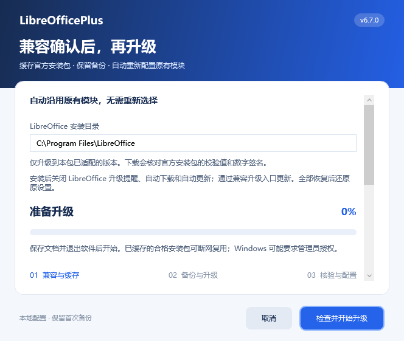

# 兼容升级与官方提醒管理

v6.7.0 安装配置时关闭当前用户的 LibreOffice 自动检查提醒、自动下载和 MAR 增量自动更新。

| 配置节点 | 属性 | 安装值 |
| --- | --- | --- |
| `/org.openoffice.Office.Jobs/Jobs/UpdateCheck/Arguments` | `AutoCheckEnabled` | `false` |
| 同上 | `AutoDownloadEnabled` | `false` |
| `/org.openoffice.Office.Update/Update` | `Enabled` | `false` |

来源：[官方在线更新说明](https://help.libreoffice.org/latest/en-US/text/shared/optionen/online_update.html)、[26.8.1.1 更新配置定义](https://github.com/LibreOffice/core/blob/bf6ef2662401c7d6dce671ab4deb26ee0af3a7c1/officecfg/registry/schema/org/openoffice/Office/Update.xcs)、[26.2.5.2 更新配置定义](https://github.com/LibreOffice/core/blob/cd7284b4cbbfeb507e630c1aac019f4157393acb/officecfg/registry/schema/org/openoffice/Office/Update.xcs)。新更新器是独立开关，只关闭旧提醒不足以关闭增量更新。

这些是可恢复的用户设置，不删除更新组件、不修改安装目录或系统策略。首次值纳入原有备份；部分模块恢复时保持关闭，最后一个模块恢复时才还原原值。用户手动改回、企业策略、其他用户、软件管理器或直接运行安装程序仍可更新本体。已有正在运行的更新不会被强制终止。

## 用户操作

1. 解压完整新版包，先运行 `安装.vbs`，给原有模块应用本版更新设置。
2. 今后双击 **`兼容升级.vbs`**，也可从配置窗口点击“兼容升级”。保存文档并完全退出软件，点击“检查并开始升级”。
3. 助手核对当前完整版本、构建及 x86-64 程序，选择本包已适配的更高版本。当前已是最高兼容版本时不重复安装，不自动降级。没有所需版本时点击“获取新版配置包”，只打开本项目正式发布页。
4. 下载官方 MSI 到本地缓存，按包内固定的 SHA-256 和 The Document Foundation 数字签名验证；已有合格缓存可断网复用，签名信任检查可能仍依赖系统证书服务。下载不完整、校验失败或签名无效时不会启动安装。
5. 保存升级前的界面与设置、首次恢复备份和已用模块，再运行 Windows Installer。可能需要 Windows 管理员授权；拒绝授权或安装失败会保留备份与进度，不显示成功。
6. 安装后再次核对完整版本与构建，重新配置原先已安装的全部模块，并继续关闭官方自动更新。Windows 要求重启时先重启，再运行本入口完成配置；已安装目标版本时只继续配置，不重复安装。

当前唯一升级目标为 **26.8.1.1**，允许从已适配的 26.2.5.2 或 26.2.6.1 升级。每次加入新目标须先添加并验证该版本资源和兼容矩阵，再更新 `package/upgrade-targets.json`；不会直接跟随官方最新版本或在线执行第三方脚本。

官方安装包采用固定[归档地址](https://downloadarchive.documentfoundation.org/libreoffice/old/26.8.1.1/win/x86_64/LibreOffice_26.8.1.1_Win_x86-64.msi)，[官方 SHA-256](https://downloadarchive.documentfoundation.org/libreoffice/old/26.8.1.1/win/x86_64/LibreOffice_26.8.1.1_Win_x86-64.msi.sha256)于 2026-10-13 核对为 `c6298b10cfa1748bcbedad94c62ce771e240e5021bfd6d7a967cd571b04b5312`。安装包不包含在项目 ZIP 内，也不由项目重新分发。

## 缓存、备份与失败恢复

目录为 `%LOCALAPPDATA%\LibreOfficePlus\upgrades`：

- `cache/<构建编号>/installer.msi`：每个清单目标一个已验证安装包，每次使用前重新核验。本版清单只有一个目标，因此最多一个 MSI；后续扩大清单时须同时评审保留策略。
- `transactions/<记录编号>/`：升级前设置、界面、首次恢复记录与本地安装日志。成功后仅保留最近两次完成快照；未完成记录、未知目录和首次恢复备份不参与清理。缓存与备份可能含用户设置和本地路径，不会提交到仓库或发布包。
- `pending.json`：未完成升级的目标、原有模块与阶段。只允许匹配同一安装目录和已适配构建的操作继续；不覆盖无法匹配的未完成记录。

失败后保留目录，再次运行本入口。构建不匹配时不应用新版界面；需检查安装日志及实际安装结果。**本助手不自动回滚或卸载软件本体**；恢复原界面只恢复用户设置，不能代替本体降级。升级前快照保留以便人工排查，不会把旧版界面自动覆盖到未知新版本。

## 验证边界

安装及恢复测试覆盖三个开关原值、重复配置、旧备份迁移与部分恢复。升级测试在隔离配置下替换网络、签名与 MSI 调用，检查离线缓存、拒绝损坏/未签名文件、运行中阻止、失败重试、重启继续、安装后构建核验及原有模块重新配置；这些不等于在每台电脑完成真实管理员安装。

原生验证在 26.2.6.1 与 26.8.1.1 的隔离用户配置中执行，三个开关关闭和恢复共 12 项读取通过，见[更新开关验收.json](更新开关验收.json)。真实目标 MSI 的 SHA-256 与官方数字签名已核验通过，但升级调用测试仍为模拟。

开发验收没有升级当前机器。真实 UAC 授权、Windows Installer 安装及重启过程仍需在目标机器或虚拟机验证。关闭官方自动更新后应定期获取本项目已适配更新，避免长期停留在缺少安全修复的版本。
